<div align="center" id="中文">


# EasySlides

**从研究材料到可编辑的学术 PPT。**

[效果展示](#examples) · [快速开始](#get-started) · [模板与主题](#templates) · [文档](#docs) · [English](#english)

[](https://www.npmjs.com/package/easyslides)
[](LICENSE)

</div>

EasySlides 是面向科研汇报的 Agent 插件，用于论文组会、学术报告和答辩。读取论文与研究材料，组织内容、搭配图表与模板，输出可编辑 PPTX。

- **学术内容**：围绕研究问题组织证据，保留图表来源。
- **可编辑交付**：原生制作或图片重建，支持文字与图形编辑；保留的论文原图仍为图片。
- **模板复用**：沿用已有 PPT 的视觉结构，也可选用内置模板与学科配图。

<a id="examples"></a>

## 效果展示

| 原生可编辑 | 先生图，再重建为可编辑 PPT |
| --- | --- |
| [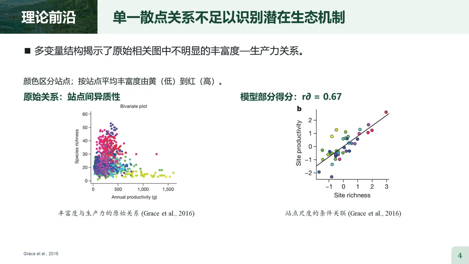](assets/readme/native-editable.png) | [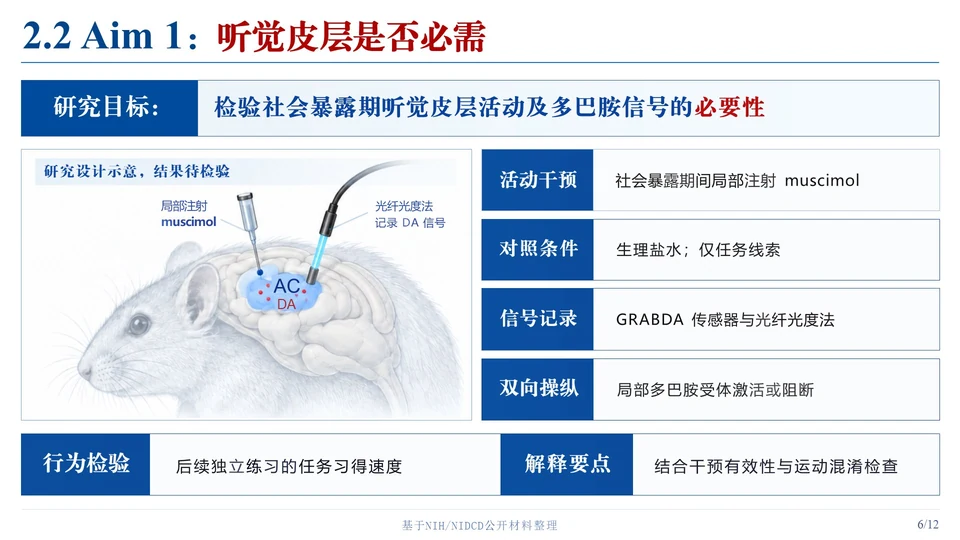](https://easyslides.scansci.com/?view=detail&work=5) |

**近期重点增强：默认原生模板 `academic_general`**，根据论文证据和每页的阅读任务自动选择版式，支持数据汇合、可编辑方法图、多图对照，以及条形图、点图等数量比较。

<details>
<summary><strong>展开看原生方法页</strong></summary>

[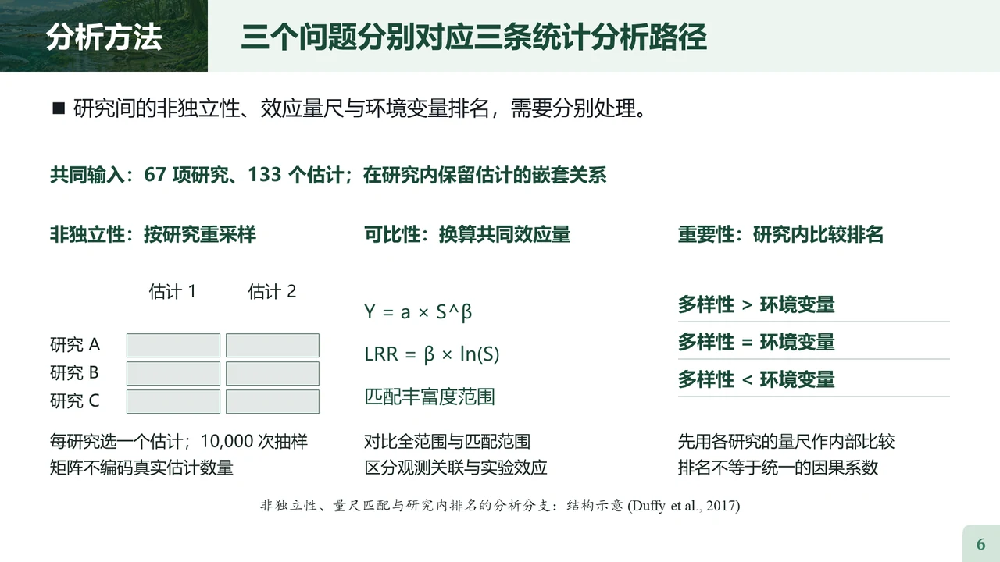](assets/readme/native-method.png)

</details>

[浏览更多成稿](https://easyslides.scansci.com/) · [更新记录](CHANGELOG.md)

<a id="get-started"></a>

## 快速开始

**DeepSeek Harness**：在「插件 → 添加插件 → npm」输入 `easyslides`，或运行：

```sh
dsh plugin --profile desktop add easyslides
```

**其他 Agent（如 Codex、Qoder）**：发送以下提示词：

```text
帮我安装这个插件: https://github.com/Rimagination/easyslides
```

安装后上传论文，输入：

```text
用 easyslides 把这篇论文做成 15–20 分钟的专业组会 PPT。
```

<a id="choose-path"></a>

## 制作流程

先确认选择，再开始制作；已经明确的信息不重复询问。

1. **制作路径**：选择原生可编辑，或先生图再重建。图片路线另选整页／局部重建，以及全图矢量重建／保留复杂配图。
2. **主题色与模板**：先确认用户指定的主题色，再选模板；原生路线未指定模板时使用 `academic_general`。
3. **主题图**：复用十四个学科门类的图片、生成专属主题图，或使用你提供的图片，按各页版式裁剪复用。
4. **汇报信息与审阅**：核对学科、听众、汇报人、学校和日期后制作，检查内容与实际渲染；身份信息可省略。

| 路径 | 适用需求 | 相对 Token／耗时 |
| --- | --- | --- |
| 原生制作 | 持续修改文字、图形与编排 | 中／中 |
| 图片重建 | 先确定页面视觉，再重建选定元素 | 高／长，生图用量另计 |

<a id="templates"></a>

## 模板与主题

### 默认模板与学科主题图

`academic_general` 按材料中的学科匹配十四类主题图，裁剪复用于封面、目录、页眉和结尾；主题色由用户指定，文字与图形保持原生可编辑。也可生成专属主题图或使用自带图片。

<p align="center">
  <a href="assets/readme/discipline-themes.jpg">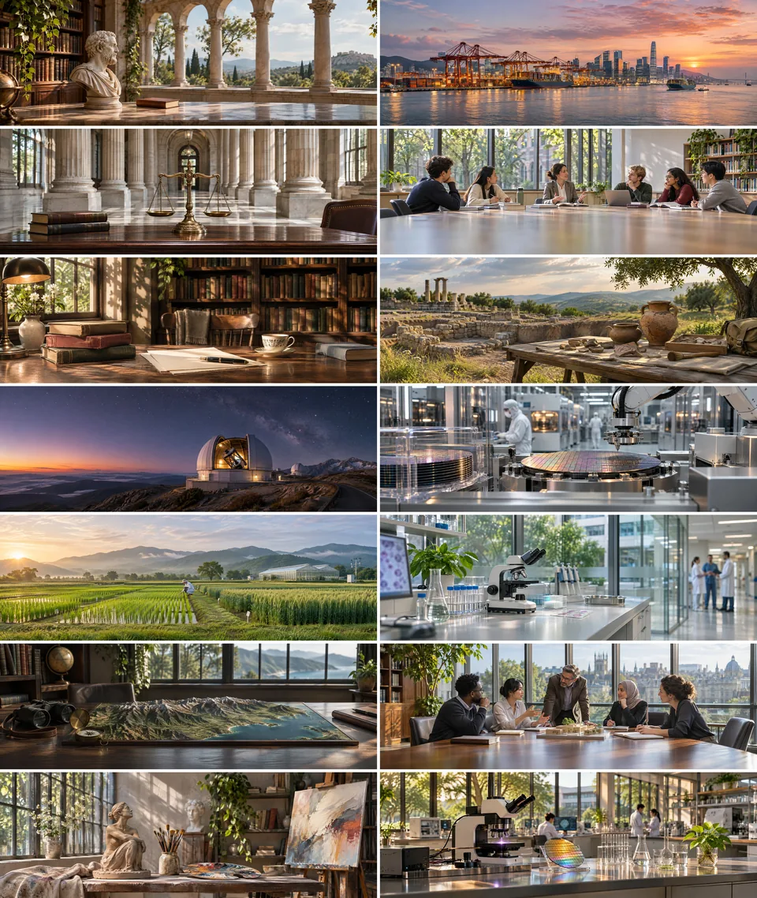</a>
</p>

<a id="choose-color"></a>

### 主题色示例

以下仅为配色示例。**用户可自行指定主题色**，使用颜色名称、自定义色值或学校／课题组规范，均以用户选择为准。

| 学术深蓝 · 历史学 | 清华风紫 · 文学 |
| --- | --- |
| [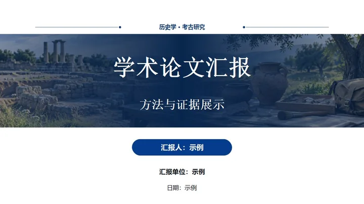](assets/readme/theme-academic-blue.jpg) | [](assets/readme/theme-academic-purple.jpg) |

| 深绿色 · 农学 | 科技蓝 · 工学 |
| --- | --- |
| [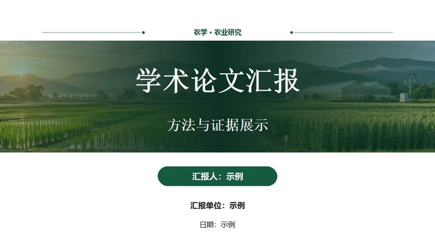](assets/readme/theme-academic-green.jpg) | [](assets/readme/theme-technology-blue.jpg) |

配色与学科不绑定。[查看整套示例](templates/layouts/academic_general/assets/theme_palette_preview.png)

<a id="choose-template"></a>

### 风格模板

八套正式原生模板，点击缩略图查看大图。

<details open>
<summary><strong>查看全部八套原生模板</strong></summary>

| 模板与页面组织 | 预览 |
| --- | --- |
| `academic_general`<br>默认增强学术模板 | [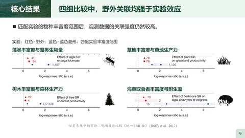](site/assets/slides/work-09/slide-09.jpg) |
| `academic_classic`<br>经典通用学术版式 | [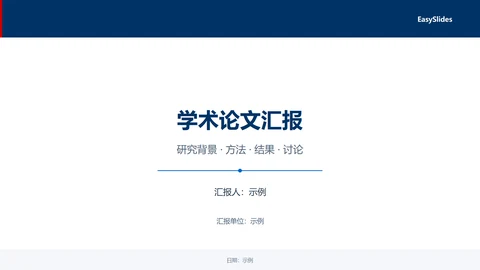](assets/readme/template-academic-classic.png) |
| `academic_scqa`<br>情境、冲突、问题与回答 | [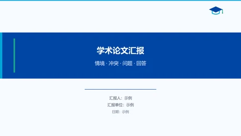](assets/readme/template-academic-scqa.png) |
| `defense_leftnav`<br>左侧章节导航答辩 | [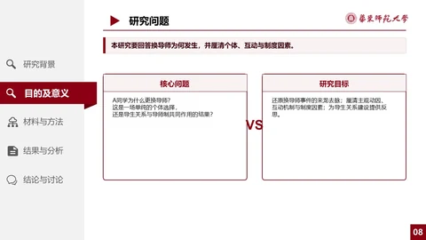](site/assets/slides/work-02/slide-08.jpg) |
| `defense_topnav`<br>顶部章节导航答辩 | [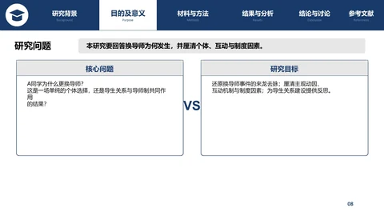](site/assets/slides/work-03/slide-08.jpg) |
| `literature_minimal`<br>简洁文献汇报 | [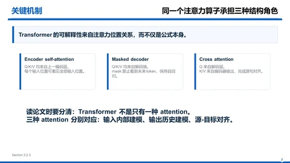](site/assets/slides/work-01/slide-08.jpg) |
| `nsfc_defense`<br>国家自然科学基金项目答辩 | [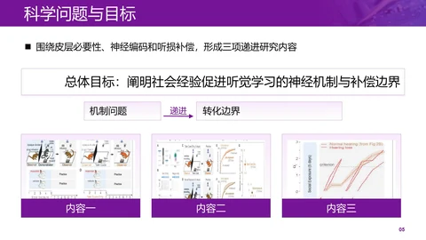](site/assets/slides/work-04/slide-05.jpg) |
| `thu_speech`<br>清华学术汇报风格 | [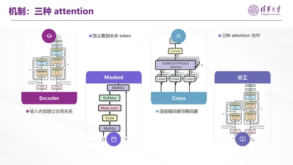](site/assets/slides/work-05/slide-08.jpg) |

</details>

<details open>
<summary><strong>图片路线：十三套参考风格</strong></summary>

三例预览，点击查看完整参考图：

| 国自然 · 绿色 | 国自然 · 紫色 | 重点研发 · 蓝色科技 |
| --- | --- | --- |
| [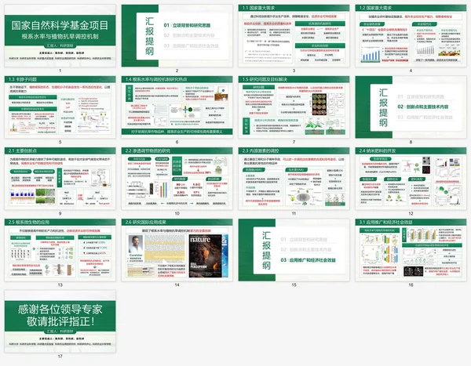](templates/image_references/nsfc_green.png) | [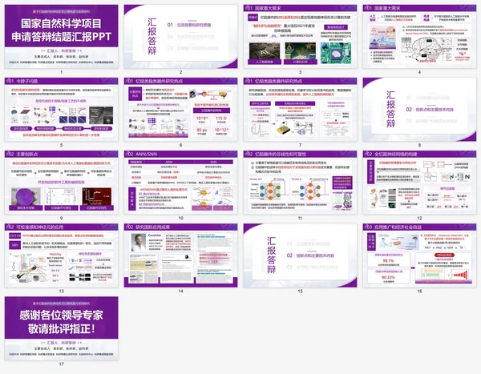](templates/image_references/nsfc_purple.png) | [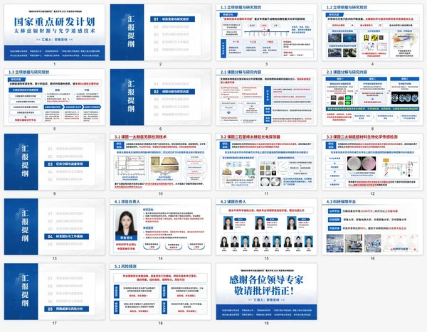](templates/image_references/rdp_blue_technology.png) |
| `nsfc_green` | `nsfc_purple` | `zdyf_blue` |

支持自带 PPT 或参考图片。[浏览全部风格](https://easyslides.scansci.com/?library=image#catalog)

</details>

<a id="docs"></a>

## 文档

[安装与环境](INSTALL.md) · [默认模板规则](references/default-academic-template.md) · [PDF 原图提取](references/scientific-figure-extraction.md) · [图片重建](workflows/slide-image-to-editable-pptx.md) · [架构](ARCHITECTURE.md) · [更新记录](CHANGELOG.md)

<details>
<summary><strong>运行条件与能力边界</strong></summary>

- **运行**：需要 Python 3.10+；预览需要 PowerPoint 或 LibreOffice。首次使用由 Agent 检查环境。
- **外部工具**：调研依赖宿主联网；生图依赖 ImageGen；PDF 结构化取图依赖 MinerU Precision 或 PDFFigures2。
- **审阅**：无图像输入能力的模型，需人工或看图模型完成视觉复核；自动检查通过不代表科学结论已核实。
- **已有 PPT**：支持蒸馏和模板复用；自动美化以检查与配色为主，复杂重排需逐项处理。
- **文件**：项目在本地管理；提交云端工具的材料按对应服务处理。

[Harness 适配](references/deepseek-harness.md) · [工作流](workflows/index.md)

</details>

## 许可与致谢

代码使用 MIT 许可，见 [LICENSE](LICENSE)；第三方模板与图片遵循各自许可。

社区链接：[LINUX DO](https://linux.do/)

<details>
<summary><strong>致谢项目</strong></summary>

感谢：[ppt-master](https://github.com/hugohe3/ppt-master) · [academic-pptx-skill](https://github.com/Gabberflast/academic-pptx-skill) · [humanize-ppt](https://github.com/LearnPrompt/humanize-ppt) · [guizang-ppt-skill](https://github.com/op7418/guizang-ppt-skill) · [paper-ppt-skill](https://github.com/xiao634zhang/paper-ppt-skill) · [literature-report-ppt-builder](https://github.com/fangyuanopus/literature-report-ppt-builder)

</details>

<a id="english"></a>

<details>
<summary><strong>English</strong></summary>

**EasySlides turns research material into editable academic presentations.** It supports native authoring, slide-image reconstruction and template reuse for journal clubs, research talks and defenses.

Install `easyslides` through DeepSeek Harness's npm plugin installer. For other agents, send the installation prompt in [Quick start](#get-started). Then upload a paper and request a presentation; confirm the production route, color, template and theme image before authoring. [Environment details](INSTALL.md).

Theme colors are user-defined. The four palettes above are examples and are not tied to particular disciplines.

The default native template `academic_general` now selects slide layouts based on the paper’s evidence and the reader’s task. It supports data-source diagrams, editable method diagrams, side-by-side figures, and bar and dot plots. Preserved research figures remain images. Final visual review needs a human or an image-capable model.

[Examples](https://easyslides.scansci.com/) · [Release status](CHANGELOG.md) · [中文](#中文)

Credits are listed above; third-party templates and images require their own permissions. Code license: [MIT](LICENSE).

</details>
